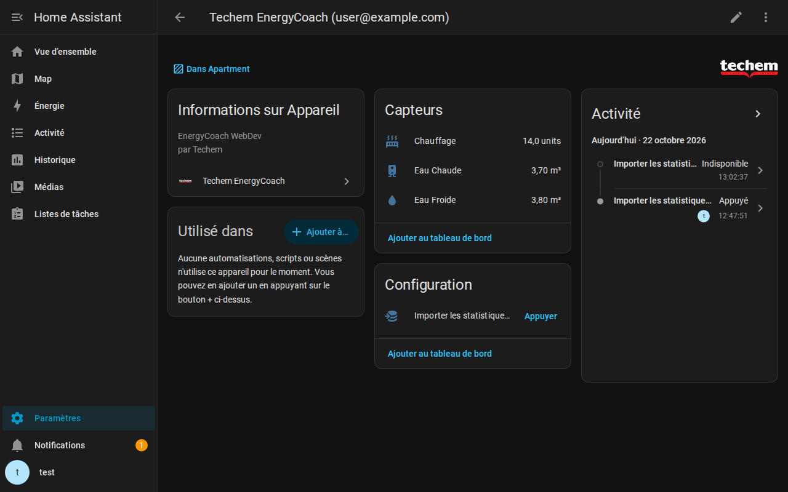
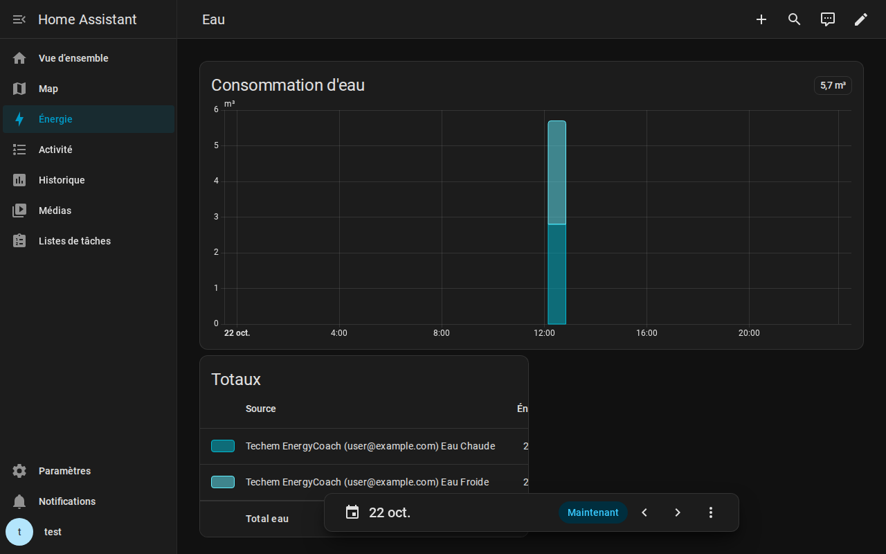
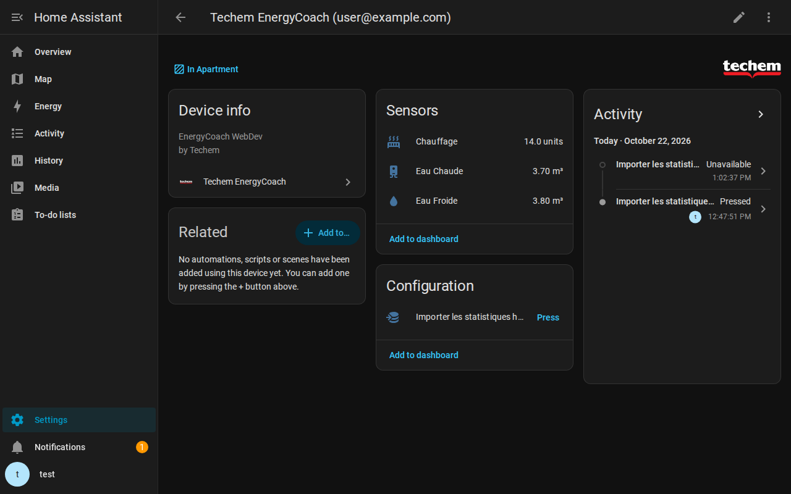
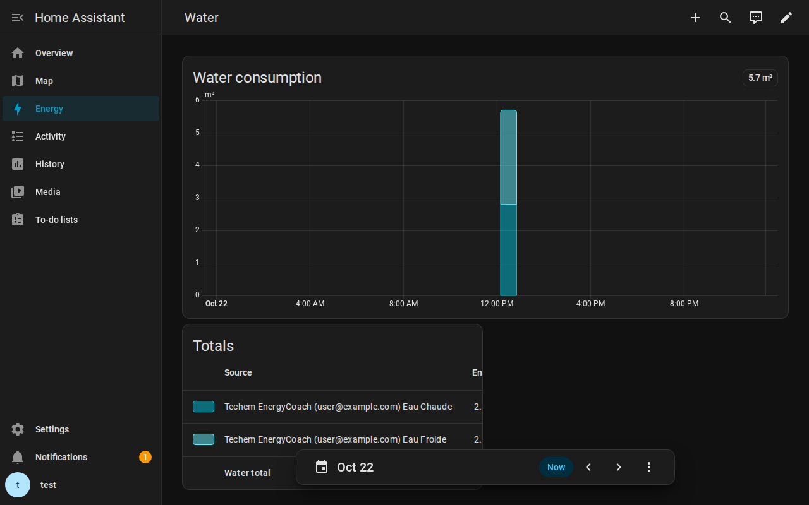

  

# Techem EnergyCoach (Belgique / Belgium) - Home Assistant Integration

> [!NOTE]
> 🇬🇧 **English documentation**: [Read the English version below](#-english).  
> 🤖 **Mention IA** : Cette description et la documentation de ce projet ont été générées avec l'aide d'une Intelligence Artificielle (IA).

---

## 🇫🇷 Français

> [!IMPORTANT]
> 🇧🇪 **Compatibilité géographique** : Cette intégration fonctionne **exclusivement pour Techem en Belgique** via le portail occupant [energycoach.techem.be](https://energycoach.techem.be/WEBENERGY_OCCUPANTS/).  
> Elle **n'est pas compatible** avec les portails Techem d'autres pays (France, Allemagne, etc.) qui s'appuient sur des infrastructures et des API totalement différentes.

Intégration personnalisée pour Home Assistant permettant de relever automatiquement vos consommations d'**eau chaude**, d'**eau froide** et de **chauffage (Divers)** depuis le portail occupant belge Techem EnergyCoach, et d'injecter l'ensemble de votre historique directement dans le **Tableau de bord Énergie (Energy Dashboard)**.

---

### 📦 Installation en 1 clic (HACS)

1. Cliquez sur le bouton bleu ci-dessus pour ouvrir le dépôt directement dans votre HACS.
2. Cliquez sur **Télécharger**, puis **redémarrez Home Assistant**.

*Ajout manuel dans HACS si le bouton ne s'ouvre pas :*
- HACS $\\rightarrow$ menu 3 points en haut à droite $\\rightarrow$ **Dépôts personnalisés**.
- URL : `https://github.com/cloom/homeassistant-techem-energycoach`, Catégorie : **Intégration**.
- Cliquez sur **Ajouter**, recherchez **Techem EnergyCoach**, téléchargez et redémarrez Home Assistant.

*(Pour une installation manuelle sans HACS, voir la [section dédiée ci-dessous](#%EF%B8%8F-installation-manuelle-sans-hacs)).*

---

### 🔧 Configuration

1. Dans Home Assistant, allez dans **Paramètres** $\\rightarrow$ **Appareils et Services**.
2. Cliquez sur **Ajouter une intégration** en bas à droite et recherchez **Techem EnergyCoach**.
3. **Étape 1** : Entrez votre e-mail et votre mot de passe du portail [energycoach.techem.be](https://energycoach.techem.be/WEBENERGY_OCCUPANTS/).
4. **Étape 2** : Vérifiez l'adresse détectée, sélectionnez les compteurs à activer, et laissez cochée la case d'import automatique de l'historique pour alimenter immédiatement votre Dashboard Énergie.
5. Validez : votre appareil et vos capteurs sont immédiatement disponibles !

---

### ✨ Aperçu

*Vue de l'appareil Techem EnergyCoach et de ses capteurs dans Home Assistant (données personnelles masquées / REDACTED).*

*Intégration dans le tableau de bord Énergie de Home Assistant.*

---

### ✨ Fonctionnalités

* 🇧🇪 **Dédié à Techem Belgique** : Spécialement conçu pour le portail WebDev 26 d'[energycoach.techem.be](https://energycoach.techem.be/WEBENERGY_OCCUPANTS/).
* 💧 **Eau Froide & Eau Chaude** : Relevés en $\\text{m}^3$ (conversion automatique depuis les hectolitres : $1\\text{ hL} = 0.1\\text{ m}^3$).
* 🔥 **Chauffage (Divers)** : Relevés en unités de répartition (souvent intitulé "Divers" sur les décomptes et le portail Techem).
* ⚡ **Prêt pour le Dashboard Énergie** :
  * Capteurs configurés avec `device_class: water` et `state_class: total_increasing`.
  * S'ajoute directement dans la section **Eau** et **Énergie** de Home Assistant.
* 🧙‍♂️ **Configuration guidée en 2 étapes (UI Config Flow)** :
  1. **Étape 1 (Identifiants)** : Saisie sécurisée de l'e-mail et du mot de passe du portail.
  2. **Étape 2 (Découverte & Sélection)** : Affiche l'adresse de votre logement, détecte automatiquement les compteurs installés et vous permet de cocher/décocher ceux que vous souhaitez suivre.
* 🕒 **Importation historique multi-années & bimensuelle (15 jours)** :
  * **Auto-import initial sur demande** : Possibilité d'injecter automatiquement l'intégralité de votre historique dès l'installation (case à cocher à l'étape 2), ou manuellement via le bouton dédié.
  * **Granularité bimensuelle (15 jours)** : Récupère les 24 quinzaines des 12 derniers mois (1er et 16 de chaque mois). Les vues Jour/Semaine détaillent les quinzaines et la vue Mois les regroupe automatiquement.
  * **Historique annuel multi-années** : Remonte aussi loin que les données sont archivées sur votre compte Techem (ex. 7 à 8 ans d'historique annuel selon votre historique de logement) à partir des décomptes annuels officiels.
  * **Dé-duplication intelligente** : Calcule le reliquat exact de l'année de transition (`décompte annuel - somme des quinzaines`) afin d'éviter tout double comptage.
* 🛡️ **Bouton d'importation sécurisé avec notifications** :
  * Bouton désactivé par défaut (catégorisé en `Configuration`) pour éviter toute exécution accidentelle.
  * Protection contre les clics concurrents (`en_cours`).
  * Envoi d'une notification persistante dans Home Assistant dès la fin de l'import (succès ou erreur).
* ⚙️ **Roue crantée / Menu Options (Options Flow)** :
  * Modification à tout moment des compteurs activés.
  * Réglage de la cadence de relève (`scan_interval`) entre **1 heure (3600s)** et **24 heures (86400s)** (recommandé : 24h).
  * Choix de la granularité (bimensuelle ou mensuelle) et activation de l'historique annuel.
* 🚀 **Client ultra-léger & performant** :
  * Requêtes HTTP directes vers le portail.
  * **Aucun navigateur headless lourd (Chromium/Playwright/Selenium) requis** : exécution en moins de 2 secondes, empreinte mémoire quasi nulle.

---

### 📊 Configuration du Dashboard Énergie

1. Allez dans **Paramètres** $\\rightarrow$ **Tableaux de bord** $\\rightarrow$ **Énergie**.
2. Dans la section **Consommation d'eau**, cliquez sur **Ajouter une source d'eau** :
   * Ajoutez le capteur d'eau froide : `sensor.techem_<id>_eau_froide`
   * Ajoutez le capteur d'eau chaude : `sensor.techem_<id>_eau_chaude`
3. Si vous n'aviez pas coché l'auto-import initial ou si vous souhaitez réimporter l'historique ultérieurement :
   * Allez sur l'appareil **Techem EnergyCoach** dans vos appareils Home Assistant.
   * Activez l'entité de bouton (catégorie Configuration) et cliquez sur **"Importer les statistiques historiques (Dashboard Énergie)"**.
   * Une notification Home Assistant vous confirmera la fin de l'importation.

---

### ⏱️ Cadence et heure de synchronisation

* **Cadence de relève** : Accessible via la **roue crantée (Configurer)** de l'intégration. Vous pouvez régler l'intervalle entre 3 600 secondes (1 heure) et 86 400 secondes (24 heures). La valeur par défaut de **24 heures** est idéale car Techem ne publie de nouveaux relevés qu'une à deux fois par mois.
* **Heure du relevé quotidien** : Par défaut, la mise à jour s'effectue 24h après le dernier redémarrage ou rechargement de l'intégration. Si vous souhaitez fixer une heure précise (ex. tous les matins à 06:00), vous pouvez désactiver la mise à jour automatique dans les *Options système* de l'intégration et créer une automatisation Home Assistant appelant `homeassistant.update_entity` sur l'un de vos capteurs Techem.

---

### 🛠️ Installation manuelle (sans HACS)

1. Téléchargez l'archive du dépôt ou clonez-le.
2. Copiez le dossier [`custom_components/techem_energycoach/`](custom_components/techem_energycoach/) dans votre dossier Home Assistant `/config/custom_components/techem_energycoach/`.
3. Redémarrez Home Assistant.

---

### ⚠️ Avertissement légal

Ce projet est une initiative open source indépendante et n'est ni affilié, ni sponsorisé, ni validé par la société Techem.

---

### 🤖 Genèse & Vibe Coding

Ce projet est né d'un script d'exploration créé par [@cloom](https://github.com/cloom) pour extraire les données du portail occupant de Techem.

L'intégralité de l'architecture du composant Home Assistant, la rétro-ingénierie du protocole WebDev 26, le Config Flow en 2 étapes, le moteur d'injection de statistiques historiques dans l'Energy Dashboard, les garde-fous de sécurité et le banc de test Docker ont été **vibe-codés en pair-programming avec [Antigravity](https://deepmind.google/) propulsé par Gemini 3.8 Flash (High)**.

---
 

## 🇬🇧 English

> [!NOTE]
> 🤖 **AI Disclosure**: This description and project documentation were generated with the assistance of Artificial Intelligence (AI).

> [!IMPORTANT]
> 🇧🇪 **Geographical Compatibility**: This integration works **exclusively for Techem in Belgium** via the occupant portal [energycoach.techem.be](https://energycoach.techem.be/WEBENERGY_OCCUPANTS/).  
> It is **NOT compatible** with Techem portals from other countries (France, Germany, etc.), which operate on completely different platforms and APIs.

Home Assistant custom integration to automatically collect **hot water**, **cold water**, and **heating (Divers)** consumption data from the Belgian Techem EnergyCoach occupant portal, and backfill your complete historical data directly into the **Home Assistant Energy Dashboard**.

---

### 📦 1-Click Installation (HACS)

1. Click the blue button above to open the repository directly inside HACS.
2. Click **Download**, then **restart Home Assistant**.

*Manual addition in HACS if the button does not open:*
- HACS $\\rightarrow$ 3 dots menu in the top right $\\rightarrow$ **Custom repositories**.
- URL: `https://github.com/cloom/homeassistant-techem-energycoach`, Category: **Integration**.
- Click **Add**, search for **Techem EnergyCoach**, download, and restart Home Assistant.

*(For manual installation without HACS, see the [section below](#%EF%B8%8F-manual-installation-without-hacs)).*

---

### 🔧 Configuration

1. In Home Assistant, go to **Settings** $\\rightarrow$ **Devices & Services**.
2. Click **Add Integration** in the bottom right corner and search for **Techem EnergyCoach**.
3. **Step 1**: Enter your email and password for [energycoach.techem.be](https://energycoach.techem.be/WEBENERGY_OCCUPANTS/).
4. **Step 2**: Verify your dwelling address, select active meters, and leave the automatic import checkbox enabled to backfill your Energy Dashboard immediately.
5. Submit: your device and sensors are ready to use!

---

### ✨ Overview

*View of the Techem EnergyCoach device and sensors in Home Assistant (personal data redacted).*

*Integration with Home Assistant Energy Dashboard.*

---

### ✨ Features

* 🇧🇪 **Dedicated to Techem Belgium**: Built specifically for the WebDev 26 portal at [energycoach.techem.be](https://energycoach.techem.be/WEBENERGY_OCCUPANTS/).
* 💧 **Cold & Hot Water**: Readings in $\\text{m}^3$ (automatic conversion from hectoliters: $1\\text{ hL} = 0.1\\text{ m}^3$).
* 🔥 **Heating (Divers)**: Allocation units readings (often labeled as "Divers" on Techem portals and statements).
* ⚡ **Energy Dashboard Native Support**:
  * Sensors configured with `device_class: water` and `state_class: total_increasing`.
  * Integrates seamlessly into the **Water** and **Energy** sections of Home Assistant.
* 🧙‍♂️ **2-Step Setup Flow (UI Config Flow)**:
  1. **Step 1 (Credentials)**: Secure login with portal email and password.
  2. **Step 2 (Discovery & Meter Selection)**: Displays your dwelling address, automatically identifies installed meters, and allows you to select which ones to track.
* 🕒 **Multi-Year & Semi-Monthly (15-day) Historical Import**:
  * **Initial Auto-Import on Demand**: Option to automatically backfill your complete historical data upon setup (opt-in checkbox in Step 2), or manually via the dedicated button.
  * **Semi-monthly (15-day) Granularity**: Retrieves 24 bi-monthly periods over the rolling 12 months (placed at day 1 and 16 of each month). Day/Week views display fine-grained quinzaines while the Month view groups them cleanly.
  * **Multi-year Annual History**: Backfills as far back as data is archived on your Techem account (e.g. 7 to 8 years depending on your residency) using Techem's official annual statements.
  * **Smart Transition-Year De-duplication**: Calculates the exact unrecorded remainder (`annual statement - sum of quinzaines`) to eliminate double counting.
* 🛡️ **Safeguarded Import Button with Notifications**:
  * Button disabled by default (categorized under `Configuration`) to prevent accidental clicks.
  * Concurrent click protection (`in_progress` guard).
  * Sends a persistent notification in Home Assistant upon completion (success or error).
* ⚙️ **Options Flow (Cog Wheel Menu)**:
  * Enable or disable individual meters at any time.
  * Adjust polling cadence (`scan_interval`) between **1 hour (3600s)** and **24 hours (86400s)** (recommended: 24h).
  * Toggle multi-year history and switch between semi-monthly and monthly granularity.
* 🚀 **Ultra-lightweight & Fast**:
  * Direct HTTP requests against the portal.
  * **No heavy headless browser (Chromium/Playwright/Selenium) required**: runs in under 2 seconds with negligible memory footprint.

---

### 📊 Energy Dashboard Setup

1. Navigate to **Settings** $\\rightarrow$ **Dashboards** $\\rightarrow$ **Energy**.
2. Under **Water consumption**, click **Add water source**:
   * Add cold water: `sensor.techem_<id>_eau_froide`
   * Add hot water: `sensor.techem_<id>_eau_chaude`
3. If you did not use the initial auto-import or want to run a fresh import later:
   * Go to the **Techem EnergyCoach** device page in Home Assistant.
   * Enable the button entity (Configuration category) and press **"Import Historical Statistics (Energy Dashboard)"**.
   * A Home Assistant persistent notification will confirm completion.

---

### ⏱️ Polling Cadence and Timing

* **Polling Interval**: Configurable via the **cog wheel (Configure / Options)** on the integration card. Values range from 3,600s (1 hour) to 86,400s (24 hours). The default **24 hours** is optimal since Techem only updates meter readings once or twice per month.
* **Exact Time of Daily Poll**: By default, Home Assistant schedules updates 24 hours after integration startup/reload. To enforce a specific schedule (e.g. 06:00 AM every day), disable automatic updates under integration *System Options* and configure a standard Home Assistant automation triggering `homeassistant.update_entity` on any Techem sensor.

---

### 🛠️ Manual Installation (Without HACS)

1. Download the repository archive or clone it.
2. Copy the [`custom_components/techem_energycoach/`](custom_components/techem_energycoach/) directory into your Home Assistant directory: `/config/custom_components/techem_energycoach/`.
3. Restart Home Assistant.

---

### ⚠️ Legal Disclaimer

This project is an independent open-source initiative and is not affiliated with, endorsed by, or sponsored by Techem.

---

### 🤖 Genesis & Vibe Coding

This project originated from an exploration script by [@cloom](https://github.com/cloom) to extract data from the Techem occupant portal.

The entire Home Assistant integration architecture, WebDev 26 protocol reverse-engineering, 2-step config flow, 1-click historical statistics import engine, safeguard protections, and Docker test harness were **vibe-coded in pair-programming with [Antigravity](https://deepmind.google/) powered by Gemini 3.8 Flash (High)**.
